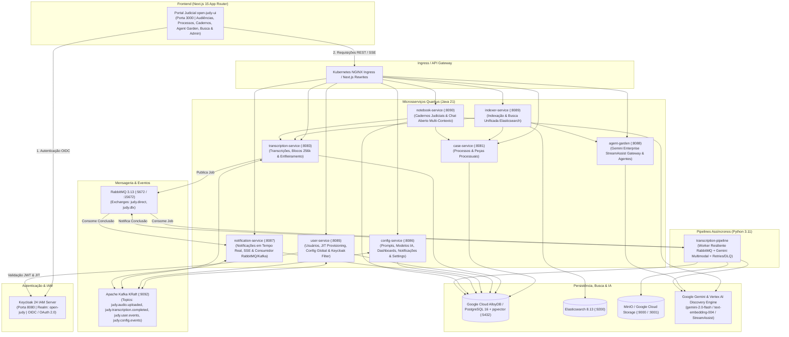

# Open Judy ⚖️🤖

> **Plataforma Aberta de Inteligência Artificial para o Poder Judiciário**
> Transcrição de Audiências, Diarização de Falas, Cadernos Judiciais Multi-Contexto, Agent Garden (Gemini Enterprise), Busca Unificada (Elasticsearch), Notificações em Tempo Real e Autenticação Zero-Trust com Keycloak IAM, Google Gemini, Quarkus, AlloyDB e Next.js.

[](https://quarkus.io)
[-blue?logo=keycloak)](https://www.keycloak.org)
[](https://ai.google.dev)
[](https://cloud.google.com/alloydb)
[](https://www.elastic.co)
[](https://nextjs.org)
[](https://kubernetes.io)

---

## 🏛️ Sobre o Open Judy

O **Open Judy** é uma solução de arquitetura orientada a microsserviços cloud-native (Kubernetes & Google Cloud) desenvolvida para acelerar e desburocratizar o trabalho de magistrados, assessores de gabinete, promotores de justiça, defensores e advogados.

Funcionalidades centrais:
1. **Autenticação & Controle de Acesso Baseado em Papéis (RBAC) com Keycloak IAM**: Autenticação unificada via OpenID Connect (OIDC / OAuth 2.0 / JWT Bearer) com clientes públicos (`open-judy-ui`) e serviços de retaguarda (`open-judy-backend`), provimento Just-In-Time (JIT) e perfis judiciais (`MAGISTRADO`, `ASSESSOR`, `ADMIN`, `ADVOGADO`).
2. **Ingestão, Diarização & Blocos Multimodais (~256k tokens) com Gemini**: Transcrição de gravações de áudio/vídeo via pipeline assíncrono resiliente (RabbitMQ + Python + Gemini 2.0 Flash) com segmentação por orador e carimbos de tempo em milissegundos.
3. **Cadernos Judiciais & Chat Aberto Multi-Contexto (`notebook-service`)**: Pesquisa comparativa combinando blocos de vídeo/transcrição, peças processuais e jurisprudência com citações verificáveis.
4. **Gemini Enterprise Agent Garden (`agent-garden`)**: Gateway integrado ao Google Cloud Discovery Engine (`StreamAssist`) para agentes jurídicos especializados (Pesquisa Jurisprudencial STF/STJ, Auditor de Contradições, Redator de Decisões e Gestor de Pautas).
5. **Busca Textual Unificada (`indexer-service` + Elasticsearch)**: Indexação e busca full-text de alta velocidade em processos, documentos anexos, transcrições de audiências e conhecimento de agentes.
6. **Central de Notificações em Tempo Real (`notification-service`)**: Alertas de conclusão de transcrição, minutas e assinaturas via Server-Sent Events (SSE), RabbitMQ e Kafka.

---

## 🏗️ Arquitetura do Sistema



---

## 🔐 Autenticação com Keycloak (OIDC / OAuth 2.0)

O Open Judy utiliza o **Keycloak 24** como servidor central de gerenciamento de identidades e acessos (IAM):

- **Realm**: `open-judy`
- **Clients**:
  - `open-judy-ui`: Cliente público com fluxo Authorization Code Flow e Direct Access Grants, incluindo protocol mappers para atributos judiciais (`courtJurisdiction`, `documentNumber`, `title`, `avatarUrl`).
  - `open-judy-backend`: Cliente Bearer-only para validação de JWTs nos microsserviços Quarkus.
- **Perfis e Permissões (RBAC)**:
  - `MAGISTRADO`: Condução de audiências, análise jurídica integral, aprovação e assinatura digital de atas.
  - `ASSESSOR`: Elaboração de minutas de atas, análise de contradições, pesquisas jurídicas e suporte ao gabinete.
  - `ADMIN`: Acesso irrestrito a usuários, configurações globais, prompts, modelos de IA e auditoria.
  - `ADVOGADO`: Acompanhamento de audiências, consulta de atas públicas e manifestações.

### Usuários de Demonstração (Seed)

| Usuário | E-mail | Senha Padrão | Perfil (Role) |
|---|---|---|---|
| `camila.vasconcelos` | `camila.vasconcelos@tjsp.jus.br` | `judy123` | `MAGISTRADO` (Juíza Titular) |
| `marcos.assessor` | `marcos.assessor@tjsp.jus.br` | `judy123` | `ASSESSOR` (Assessor de Gabinete) |
| `admin.judy` | `admin@openjudy.org` | `judy123` | `ADMIN` (Administrador de TI/IA) |
| `lucas.menezes` | `lucas.menezes@advocacia.com.br` | `judy123` | `ADVOGADO` (Representante Legal) |

---

## 📁 Estrutura de Diretórios

```
open-judy/
├── services/
│   ├── pom.xml                                   # POM Pai Maven Multi-módulo (Java 21 / Quarkus 3.15)
│   ├── Dockerfile.dev                            # Dockerfile de desenvolvimento Quarkus com hot-reload
│   ├── common-lib/                               # DTOs, Enums, Eventos de Domínio e Segurança Keycloak/IAP
│   ├── case-service/                             # Microsserviço Quarkus (:8081 - Processos e Documentos)
│   ├── transcription-service/                    # Microsserviço Quarkus (:8083 - Transcrições, Blocos 256k e RabbitMQ)
│   ├── user-service/                             # Microsserviço Quarkus (:8085 - Usuários, JIT Provisioning e Config Sistema)
│   ├── config-service/                           # Microsserviço Quarkus (:8086 - Prompts, Modelos IA, Dashboards e Settings)
│   ├── notification-service/                     # Microsserviço Quarkus (:8087 - Notificações em Tempo Real, SSE e RabbitMQ)
│   ├── agent-garden/                             # Microsserviço Quarkus (:8088 - Gemini Enterprise StreamAssist e Agentes)
│   ├── indexer-service/                          # Microsserviço Quarkus (:8089 - Busca Unificada Elasticsearch)
│   └── notebook-service/                         # Microsserviço Quarkus (:8090 - Cadernos Judiciais e Chat Multi-Contexto)
├── pipelines/
│   └── transcription-pipeline/                   # Pipeline Assíncrono em Python (RabbitMQ, Gemini, Retries e DLQ)
├── frontend/
│   └── open-judy-ui/                             # Portal Next.js 15 (:3000 - React 19, TypeScript, Tailwind CSS)
├── docker/
│   ├── entrypoint-quarkus-dev.sh                 # Entrypoint de sincronização common-lib e Quarkus Dev Mode
│   ├── init-db.sql                               # Script de inicialização PostgreSQL 16 + pgvector
│   └── keycloak/
│       └── openjudy-realm.json                   # Exportação completa do Realm Keycloak open-judy
├── k8s/
│   ├── base/                                     # Manifestos Kubernetes (Deployments, Services, ConfigMap, Secret, Ingress)
│   └── overlays/
│       ├── local/                                # Overlay Kustomize para desenvolvimento local
│       └── gke-alloydb/                          # Overlay Kustomize para produção no GKE + AlloyDB
├── terraform/
│   ├── versions.tf                               # Requisitos de versão Terraform e provider Google Cloud
│   ├── variables.tf                              # Variáveis de infraestrutura GCP (GKE, AlloyDB, GCS, IAM)
│   ├── main.tf                                   # Provisionamento VPC, GKE, AlloyDB, GCS, Artifact Registry e Workload Identity
│   ├── outputs.tf                                # Outputs de conexão para o cluster GKE e AlloyDB Auth Proxy
│   └── terraform.tfvars.example                  # Exemplo de configuração de variáveis
├── docker-compose.yml                            # Stack completa Docker Compose
├── podman-compose.yml                            # Stack completa Podman Compose (com suporte SELinux)
└── README.md
```

---

## 🚀 Como Executar

### 1. Iniciar a Stack Completa com Podman Compose ou Docker Compose

```bash
# Com Podman Compose:
podman-compose up -d

# Ou com Docker Compose:
docker compose up -d
```

### Mapa de Portas e Serviços

| Serviço | Porta Local | Descrição |
|---|---|---|
| `open-judy-ui` | `http://localhost:3000` | Portal Judicial Next.js 15 |
| `keycloak` | `http://localhost:8080` | Servidor OIDC Keycloak (`admin` / `admin`) |
| `case-service` | `http://localhost:8081` | API de Processos Judiciais e Peças (`/api/v1/cases`) |
| `transcription-service` | `http://localhost:8083` | API de Transcrições e Blocos 256k (`/api/v1/transcriptions`) |
| `user-service` | `http://localhost:8085` | API de Usuários e Config Global (`/api/v1/users`, `/api/v1/system/config`) |
| `config-service` | `http://localhost:8086` | API de Prompts, Modelos IA e Painéis (`/api/v1/config/*`) |
| `notification-service` | `http://localhost:8087` | API e Stream SSE de Notificações (`/api/v1/notifications`) |
| `agent-garden` | `http://localhost:8088` | Gateway Gemini Enterprise StreamAssist (`/api/v1/agent-garden`) |
| `indexer-service` | `http://localhost:8089` | Busca Full-Text Unificada (`/api/v1/indexer`) |
| `notebook-service` | `http://localhost:8090` | Cadernos Judiciais e Chat Aberto (`/api/v1/notebooks`) |
| `alloydb-local` | `localhost:5432` | PostgreSQL 16 + `pgvector` (`open_judy_db` / `judy_user` / `judy_password`) |
| `rabbitmq` | `localhost:5672` / `http://localhost:15672` | Broker AMQP e Console Management (`judy_user` / `judy_password`) |
| `kafka` | `localhost:9092` | Broker Apache Kafka (KRaft) |
| `elasticsearch` | `http://localhost:9200` | Motor de Busca Textual Elasticsearch 8.13 |
| `minio` | `http://localhost:9000` / `http://localhost:9001` | Object Storage S3 (`judy_minio_admin` / `judy_minio_password`) |

---

## ☁️ Provisionamento Google Cloud (Terraform) & Deploy Kubernetes (Kustomize)

### 1. Provisionar Infraestrutura no GCP com Terraform

```bash
cd terraform
cp terraform.tfvars.example terraform.tfvars
# Edite terraform.tfvars com seu project_id e credenciais
terraform init
terraform plan
terraform apply
```

### 2. Aplicar Manifestos Kubernetes com Kustomize

```bash
# Ambiente local / Minikube / Kind
kubectl apply -k k8s/overlays/local

# Ambiente Google Cloud (GKE + AlloyDB Auth Proxy)
kubectl apply -k k8s/overlays/gke-alloydb
```

---

## 📄 Licença

Distribuído sob a licença MIT. Consulte `LICENSE` para mais informações.
