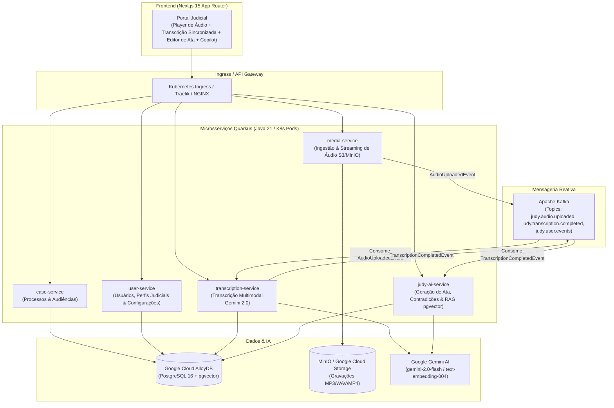

# Open Judy ⚖️🤖

> **Plataforma Aberta de Inteligência Artificial para o Poder Judiciário**
> Transcrição de Audiências, Diarização de Falas, Geração de Atas Oficiais e Copilot RAG com Google Gemini, Quarkus, AlloyDB e Next.js.

[](https://quarkus.io)
[](https://ai.google.dev)
[](https://cloud.google.com/alloydb)
[](https://nextjs.org)
[](https://kubernetes.io)

---

## 🏛️ Sobre o Open Judy

O **Open Judy** é uma solução de arquitetura orientada a microsserviços cloud-native (Kubernetes) desenvolvida para acelerar e desburocratizar o trabalho de magistrados, secretários de vara, promotores de justiça, defensores e advogados.

A primeira e principal funcionalidade é o **Módulo de Audiências Judiciais Inteligentes**:
1. **Ingestão & Diarização com Gemini**: Transcrição precisa de gravações de áudio/vídeo com segmentação por orador (`Magistrado`, `Promotor`, `Advogado do Autor/Réu`, `Autor`, `Réu`, `Testemunha`) e carimbos de tempo em milissegundos.
2. **Minuta da Ata de Audiência Automatizada**: Geração em segundos do termo oficial de audiência com cabeçalho da comarca, qualificação das presenças, síntese dos depoimentos colhidos, deliberações e despacho final de encerramento.
3. **Detector de Contradições e Análise Jurídica**: Mapeamento de teses conflitantes, pontos controvertidos e cronologia dos fatos com fundamentação em súmulas e jurisprudência (ex: Súmula 543 STJ).
4. **Copilot Judiciário com RAG Semântico**: Assistente conversacional alimentado por vetores no **AlloyDB `pgvector`** com geração de citações com links clicáveis que retrocedem/avançam o player de áudio para o trecho exato da fala.

---

## 🏗️ Arquitetura do Sistema



---

## 📁 Estrutura de Diretórios

```
open-judy/
├── backend/
│   ├── pom.xml                                   # POM Pai Maven Multi-módulo
│   ├── common-lib/                               # DTOs, Eventos de Domínio e Enums
│   ├── case-service/                             # Microsserviço Quarkus (Processos e Audiências)
│   ├── media-service/                            # Microsserviço Quarkus (Mídia e S3/GCS)
│   ├── transcription-service/                    # Microsserviço Quarkus (Transcrição Gemini)
│   ├── judy-ai-service/                          # Microsserviço Quarkus (Atas, RAG e Copilot)
│   └── user-service/                             # Microsserviço Quarkus (Usuários e Configurações)
├── frontend/
│   └── open-judy-ui/                             # Portal Next.js 15 (TypeScript, Tailwind CSS)
├── k8s/
│   ├── base/                                     # Manifestos Kubernetes (Deployments, Services, ConfigMaps, Ingress)
│   └── overlays/
│       ├── local/                                # Overlay Kustomize para desenvolvimento local
│       └── gke-alloydb/                          # Overlay Kustomize para produção no GKE + AlloyDB
├── docker-compose.yml                            # Ambiente local (Postgres+pgvector, Kafka, MinIO)
└── README.md
```

---

## 🚀 Como Executar

### 1. Iniciar Infraestrutura Local com Podman (AlloyDB/PostgreSQL + pgvector, Kafka e MinIO)

```bash
# Iniciar stack local com podman-compose
podman-compose up -d

# Verificar status dos containers
podman ps
```

Serviços expostos:
- **AlloyDB / PostgreSQL (`pgvector`)**: `localhost:5432` (`judy_user` / `judy_password`)
- **Apache Kafka**: `localhost:9092`
- **MinIO Console**: `http://localhost:9001` (`judy_minio_admin` / `judy_minio_password`)

### 2. Executar os Microsserviços Quarkus

Cada microsserviço pode ser iniciado em modo de desenvolvimento (`dev mode`):

```bash
# Terminal 1: Case Service (Porta 8081)
cd backend/case-service
./mvnw quarkus:dev

# Terminal 2: Media Service (Porta 8082)
cd backend/media-service
./mvnw quarkus:dev

# Terminal 3: Transcription Service (Porta 8083)
cd backend/transcription-service
./mvnw quarkus:dev

# Terminal 4: Judy AI Service (Porta 8084)
cd backend/judy-ai-service
./mvnw quarkus:dev
```

### 3. Executar o Frontend Next.js

```bash
cd frontend/open-judy-ui
npm install
npm run dev
```

Acesse o portal em: [http://localhost:3000](http://localhost:3000)

---

## ☸️ Deploy no Kubernetes

Para aplicar os manifestos com o **Kustomize**:

```bash
# Ambiente local / Minikube
kubectl apply -k k8s/overlays/local

# Ambiente Google Cloud (GKE + AlloyDB)
kubectl apply -k k8s/overlays/gke-alloydb
```

---

## 📄 Licença

Distribuído sob a licença MIT. Consulte `LICENSE` para mais informações.
